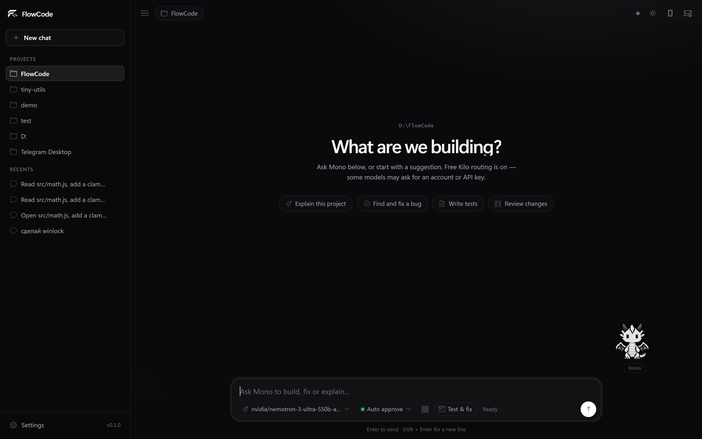
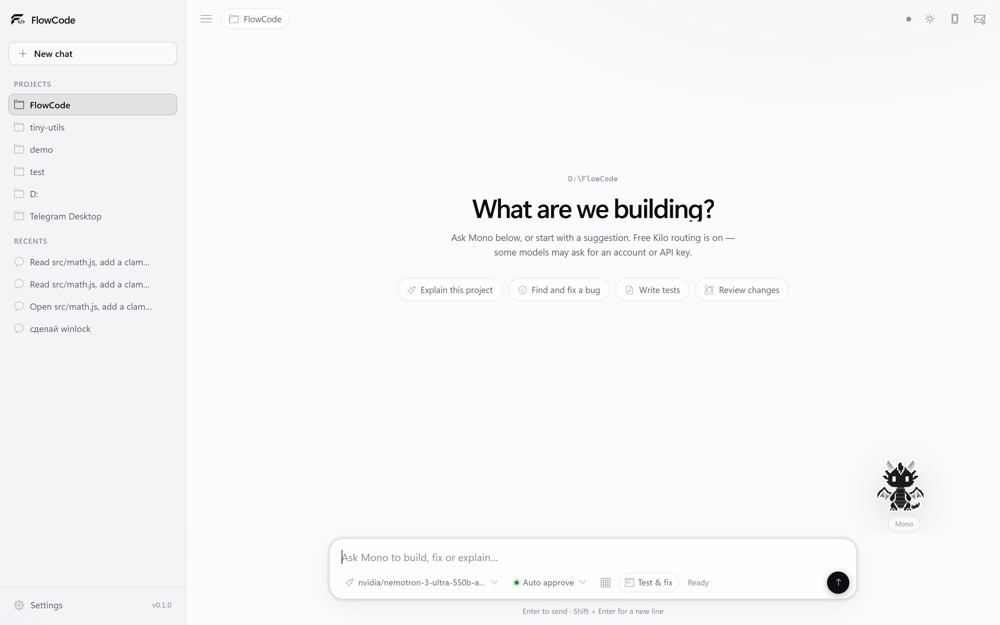
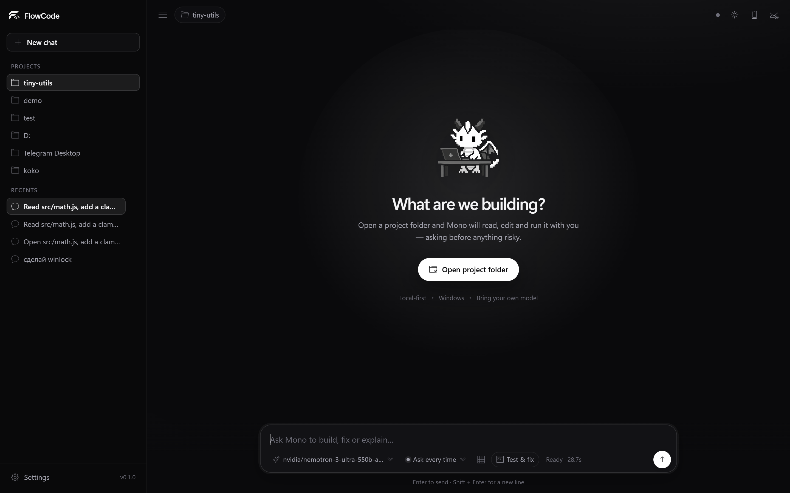
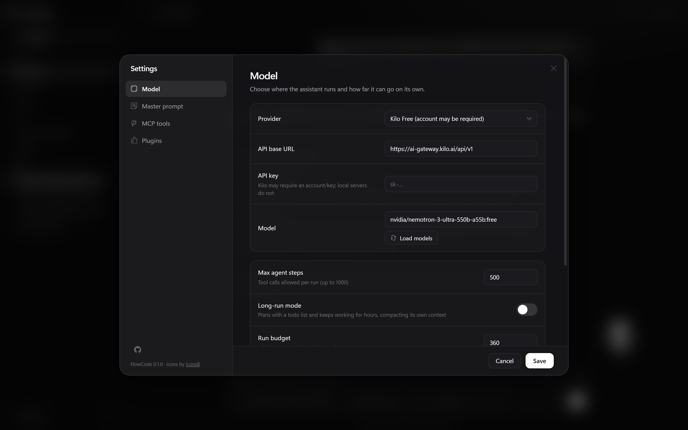
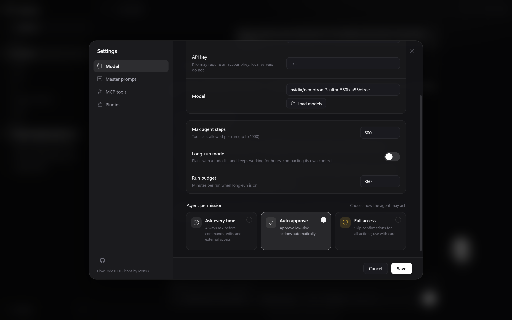
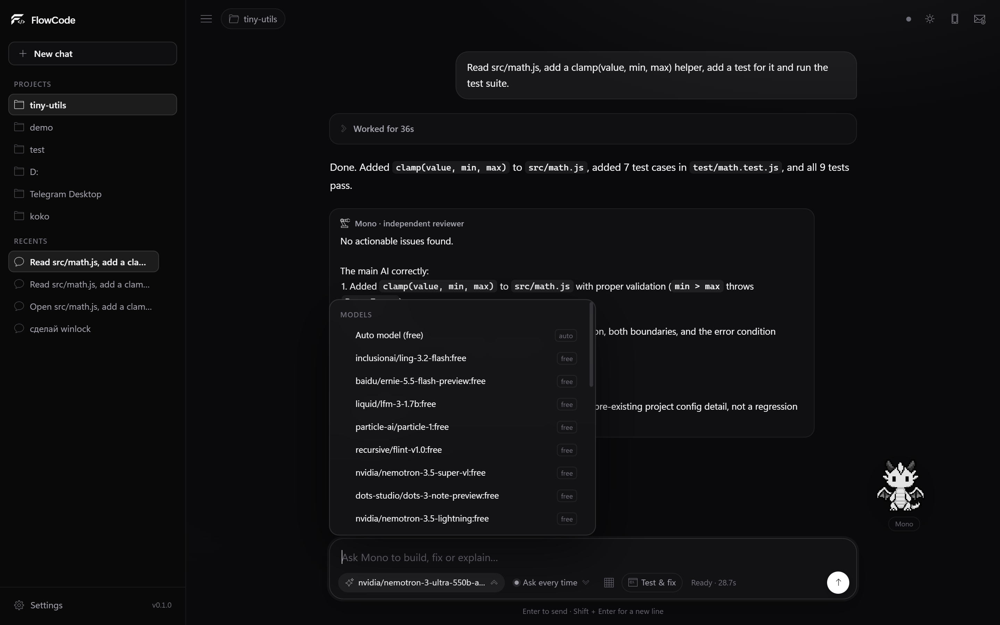
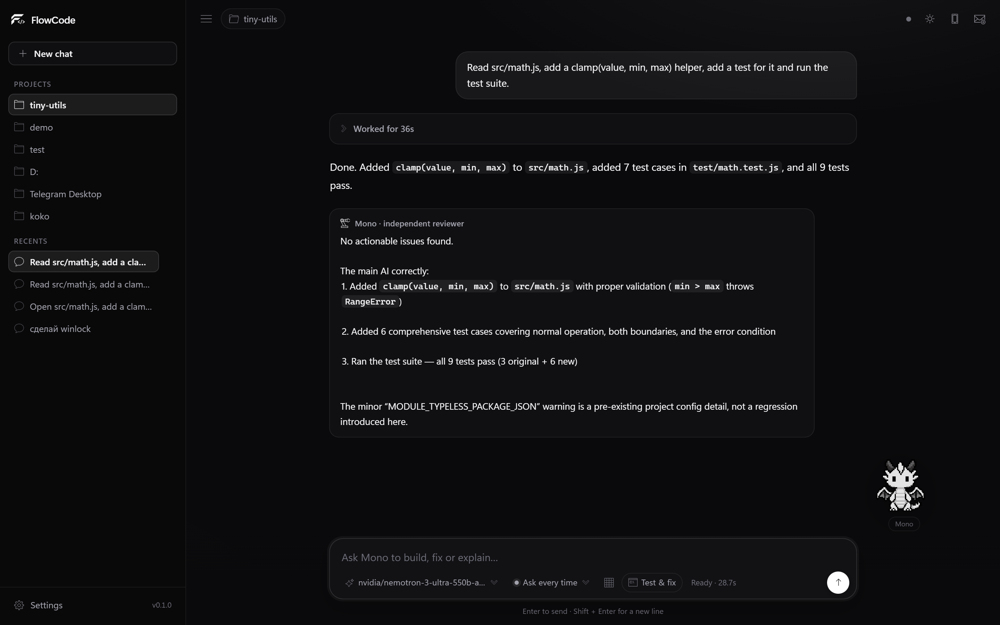

# FlowCode

[Русский](#русский) | [English](#english)



FlowCode — настольный AI-агент для разработки. Он работает с выбранной папкой проекта: читает и редактирует файлы, выполняет команды, запускает проверки и подключается к дополнительным инструментам.

## Русский

### Возможности

- Подключение моделей Kilo, Moonshot/Kimi, Ollama, LM Studio, OpenRouter и совместимых API.
- Режим **Auto model (free)** через Kilo, который маршрутизирует запросы среди доступных бесплатных моделей.
- Работа с локальными моделями через Ollama и LM Studio.
- Редактирование файлов, запуск команд, поиск по проекту и проверка изменений.
- Кнопка **Test & fix** для поиска ошибок, исправления и повторного запуска проверок.
- Три стиля системного промпта: **Safe**, **Normal** и **Anti**.
- Поддержка MCP-серверов, плагинов и мастер-промптов `.Flow`.
- Дополнительный SuperGram-плагин для работы с Telegram.
- Управление с телефона по локальной сети.

### Для пользователей: скачать и установить

Обычным пользователям не нужно собирать FlowCode из исходников. Готовый установщик Windows опубликован в [релизе v0.1.0](https://github.com/lorddnkpohf-dev/FlowCode/releases/tag/v0.1.0) как предварительная версия. Скачайте `FlowCode.Setup.0.1.0.exe` в разделе **Assets**.

### Запуск для авторизованных разработчиков

FlowCode — закрытый проприетарный проект. Публичная видимость репозитория не означает, что исходный код распространяется под open-source лицензией. Собирать приложение из исходников могут только авторизованные разработчики.

Для разработки требуются Windows x64, Node.js и npm. В авторизованной копии проекта выполните:

```powershell
npm ci
npm start
```

Для быстрой smoke-проверки:

```powershell
npm start -- --smoke
```

При первом запуске откройте папку проекта через **Open project folder** и настройте провайдера и модель в **Settings → Model**. Для провайдеров с авторизацией укажите API key. Для Ollama или LM Studio сначала запустите соответствующий локальный сервер.

Kilo Auto Free использует маршрутизацию Kilo и не обходит ограничения провайдера. При сетевой ошибке или ответе `5xx` FlowCode один раз попробует резервную бесплатную модель Kilo и покажет переключение. Автоматического переключения для обхода `429` или ошибок авторизации нет. Если Kilo просит зарегистрироваться, потребуется аккаунт/API key Kilo либо ожидание сброса лимита.

### Режимы

**Системный промпт**

- **Safe** — более осторожный подход к изменениям и потенциальным побочным эффектам.
- **Normal** — сбалансированный режим по умолчанию.
- **Anti** — прямой и творческий стиль с меньшим количеством лишних отказов.

Режимы меняют инструкции и стиль агента, но не отключают обязательные требования безопасности.

**Подтверждение действий**

- **Ask every time** — агент запрашивает подтверждение для действий, требующих разрешения.
- **Auto approve** и **Full access** — в текущей реализации оба режима пропускают подтверждения для вызовов инструментов и функционально не различаются.

Режим можно переключить в настройках или прямо в строке чата, в том числе во время выполнения. При выборе Auto approve или Full access уже ожидающие подтверждения в текущем запуске разрешаются.

### Сборка Windows EXE

Только для авторизованных разработчиков с доступом к исходному коду:

```powershell
npm ci
npm run build:win
```

Установщик NSIS появится в `dist/FlowCode Setup 0.1.0.exe`. Portable-версия будет в `dist/win-unpacked/FlowCode.exe`. Сборка не подписывается сертификатом разработчика, поэтому Windows может показать предупреждение SmartScreen.

### Мастер-промпт `.Flow`

В **Settings → Master prompt** можно задать инструкции вручную или загрузить `.Flow`-файл. Поддерживаются секции с заголовками `@section`; строки, начинающиеся с `//`, `;` или `#`, считаются комментариями.

### MCP и плагины

MCP-серверы настраиваются в **Settings → MCP tools**. Плагины размещаются в отдельных папках внутри `plugins/` и описываются файлом `plugin.json`.

SuperGram предоставляет инструменты для работы с Telegram. Подключайте аккаунт только на доверенном компьютере и учитывайте, что разрешённые действия могут читать и отправлять сообщения от имени аккаунта.

### Конфиденциальность и безопасность

- Агент получает доступ к выбранной папке и выполняет доступные ему инструменты и команды.
- Запросы и переданный контекст обрабатываются выбранным провайдером модели; ознакомьтесь с его правилами хранения данных.
- API-ключи и настройки сохраняются локально на компьютере. Не добавляйте конфигурацию с секретами в Git.
- Auto approve и Full access отключают подтверждения действий — используйте их осознанно.
- Управление с телефона использует локальный сетевой сервер. Не передавайте ссылку управления посторонним и используйте её только в доверенной сети.

### Лицензия и права

FlowCode не является open-source программой. Исходный код, приложение и связанные материалы являются проприетарными. Этот README не предоставляет лицензию на использование, копирование, изменение или распространение. Для разрешений обратитесь к владельцу проекта.

## English

FlowCode is a desktop AI coding agent. It works with a selected project folder to read and edit files, run commands and checks, and connect to additional tools.

### Features

- Connects to Kilo, Moonshot/Kimi, Ollama, LM Studio, OpenRouter, and compatible APIs.
- Includes **Auto model (free)** through Kilo, which routes requests across available free models.
- Supports local models through Ollama and LM Studio.
- Edits files, runs commands, searches projects, and checks changes.
- **Test & fix** can find issues, apply fixes, and rerun checks.
- Includes three system-prompt styles: **Safe**, **Normal**, and **Anti**.
- Supports MCP servers, plugins, and `.Flow` master prompts.
- Includes the optional SuperGram plugin for Telegram.
- Supports phone control over a local network.

### For users: download and install

Regular users do not need to build FlowCode from source. The Windows installer is published as a pre-release in [release v0.1.0](https://github.com/lorddnkpohf-dev/FlowCode/releases/tag/v0.1.0). Download `FlowCode.Setup.0.1.0.exe` from the **Assets** section.

### Running from an authorized checkout

FlowCode is proprietary closed-source software. A publicly visible repository does not mean its source code is distributed under an open-source license. Only authorized developers may build the app from source.

Development requires Windows x64, Node.js, and npm. From an authorized project checkout, run:

```powershell
npm ci
npm start
```

To run a smoke check:

```powershell
npm start -- --smoke
```

On first launch, open a project folder with **Open project folder** and configure a provider and model under **Settings → Model**. Enter an API key for providers that require authentication. Start the relevant local server before using Ollama or LM Studio.

Kilo Auto Free uses Kilo's own routing and does not bypass provider limits. On a network failure or `5xx` response, FlowCode tries one alternate free Kilo model and reports the switch. It does not automatically switch models to bypass `429` or authentication errors. If Kilo asks you to register, a Kilo account/API key or waiting for the limit to reset may be required.

### Modes

**System prompt**

- **Safe** takes a more cautious approach to changes and potential side effects.
- **Normal** is the balanced default.
- **Anti** uses a more direct, creative style with fewer unnecessary refusals.

These modes change the agent's instructions and style; they do not disable required safety rules.

**Action approvals**

- **Ask every time** asks for approval for actions that require permission.
- **Auto approve** and **Full access** currently both skip approval for tool calls and do not differ functionally.

You can change the mode in Settings or directly in the chat input, including while a task is running. Selecting Auto approve or Full access also resolves approvals already waiting in the current run.

### Building the Windows EXE

For authorized developers with access to the source code only:

```powershell
npm ci
npm run build:win
```

The NSIS installer is generated at `dist/FlowCode Setup 0.1.0.exe`. The portable build is generated at `dist/win-unpacked/FlowCode.exe`. The build is not signed with a developer certificate, so Windows SmartScreen may show a warning.

### `.Flow` master prompt

Use **Settings → Master prompt** to enter instructions or load a `.Flow` file. The parser supports `@section` headers; lines beginning with `//`, `;`, or `#` are treated as comments.

### MCP and plugins

Configure MCP servers in **Settings → MCP tools**. Plugins live in separate folders under `plugins/` and are described by a `plugin.json` file.

SuperGram provides Telegram tools. Connect an account only on a trusted computer and note that permitted actions may read and send messages on that account's behalf.

### Privacy and security

- The agent can access the selected folder and run the tools and commands available to it.
- Prompts and context sent to the model are processed by the selected provider; review that provider's data-retention policies.
- API keys and settings are stored locally. Do not commit configuration containing secrets to Git.
- Auto approve and Full access disable action confirmations; use them carefully.
- Phone control uses a local network server. Do not share its control link and use it only on a trusted network.

## Проверка антивирусами / Antivirus scan results

Источник результатов: [VirusTotal](https://www.virustotal.com/) (по информации пользователя). Перечисленные ниже движки показали `Undetected`. Результат `Unable to process file type` означает, что движок не смог проверить файл, а не то, что файл признан чистым. Ссылка на конкретный отчёт, имя файла, его хеш и дата проверки не предоставлены, поэтому эти результаты не подтверждают проверку конкретной версии FlowCode или EXE. Отсутствие срабатываний не гарантирует безопасность файла; результаты могут меняться.

Source: [VirusTotal](https://www.virustotal.com/) (as reported by the user). The engines listed below returned `Undetected`. `Unable to process file type` means an engine could not scan the file; it is not a clean verdict. The specific report URL, filename, file hash, and scan date were not provided, so these results do not confirm a scan of any specific FlowCode build or EXE. No detections do not guarantee that a file is safe, and results may change.

**Undetected:** Acronis (Static ML), AhnLab-V3, Alibaba, AliCloud, ALYac, Antiy-AVL, Arcabit, Arctic Wolf, Avast, AVG, Avira (no cloud), BitDefender, Bkav Pro, ClamAV, CMC, CrowdStrike Falcon, CTX, Cynet, DrWeb, Emsisoft, eScan, ESET-NOD32, Fortinet, GData, Google, Gridinsoft (no cloud), Huorong, Ikarus, Jiangmin, K7AntiVirus, K7GW, Kaspersky, Kingsoft, Lionic, Malwarebytes, MaxSecure, McAfee Scanner, Microsoft, NANO-Antivirus, Palo Alto Networks, Panda, QuickHeal, Rising, Sangfor Engine Zero, SecureAge, SentinelOne (Static ML), Skyhigh (SWG), Sophos, SUPERAntiSpyware, Symantec, TACHYON, TEHTRIS, Tencent, Trapmine, Trellix ENS, TrendMicro, TrendMicro-HouseCall, Varist, VBA32, VIPRE, VirIT, ViRobot, Webroot, WithSecure, Xcitium, Yandex, Zillya, ZoneAlarm by Check Point, Zoner.

**Unable to process file type:** BitDefenderFalx, Elastic, Symantec Mobile Insight, Trustlook, DeepInstinct.

### License and rights

FlowCode is not open-source software. Its source code, application, and related materials are proprietary. This README does not grant a license to use, copy, modify, or distribute them. Contact the project owner for permission.

## Репозиторий / GitHub repository

Официальная страница проекта: [lorddnkpohf-dev/FlowCode](https://github.com/lorddnkpohf-dev/FlowCode).

Official project page: [lorddnkpohf-dev/FlowCode](https://github.com/lorddnkpohf-dev/FlowCode).

## Изображения / Screenshots

| Dark | Light |
| --- | --- |
|  |  |

| Start | Settings |
| --- | --- |
|  |  |

| Permissions | Models |
| --- | --- |
|  |  |

| Chat |
| --- |
|  |

## Логотип / Logo


## Участие / Contributing

FlowCode — проприетарный проект. Исходный код не публикуется, но внести улучшения в документацию, визуальный дизайн и шаблоны репозитория может любой. Открой issue или pull request с предложением.

- Дизайн: чёрно-белая палитра, соответствующая логотипу. Цвета, градиенты и «радужные» акценты не используются.
- Иконки: Icons8. Каждый элемент интерфейса использует свою иконку, повторения нет.
- Стиль: минимализм, близкий к iPhone.

### Для разработчиков

```powershell
npm ci
npm test
npm start
```

## Безопасность / Security

Сообщайте о уязвимостях через issue, не раскрывая детали публично. API-ключ и настройки хранятся локально — не коммитьте их в Git.

## Журнал изменений / Changelog

### v0.1.1

- Минималистичный премиальный интерфейс в чёрно-белой палитре по логотипу.
- Светлая и тёмная темы с сохранением настроек.
- Обновлённые иконки Icons8 без повторов.
- Добавлены скриншоты, CI-пайплайн и шаблоны репозитория.

### v0.1.0

- Первый релиз: десктопный AI-агент с редактированием файлов, выполнением команд, проверками и поддержкой MCP/плагинов.